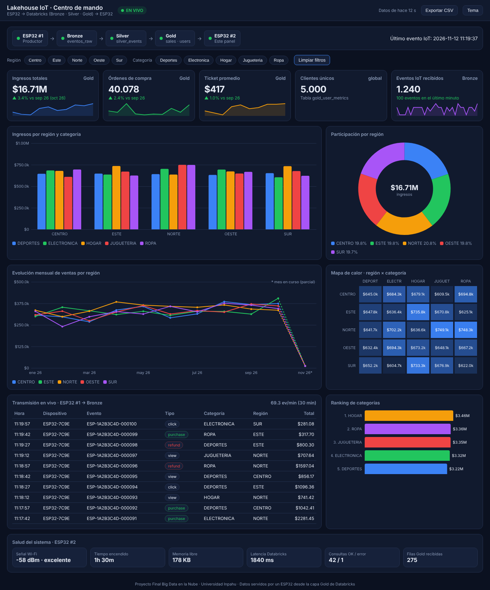
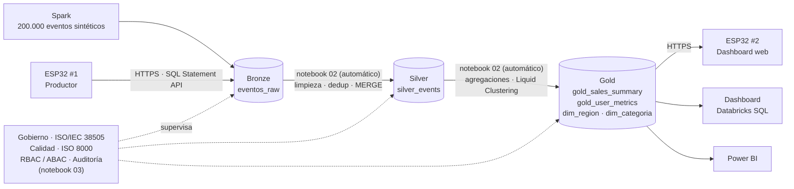
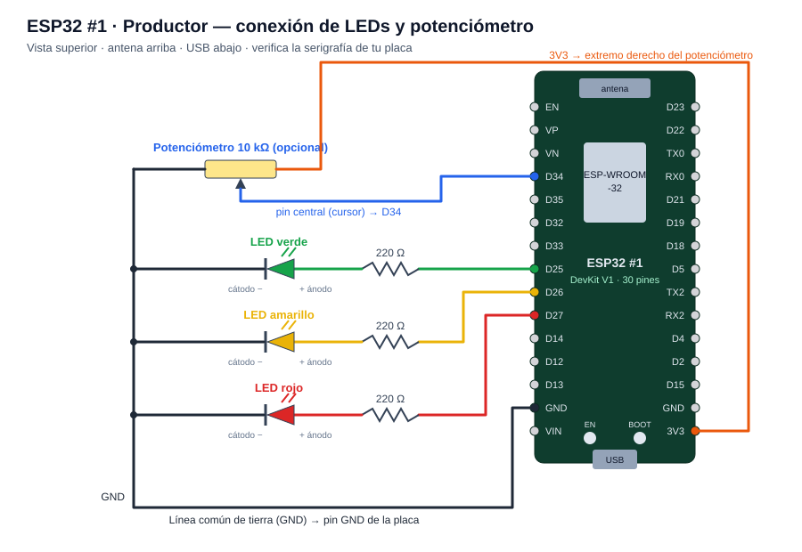

# Lakehouse Medallón con ingesta IoT desde ESP32

Proyecto final de **Big Data en la Nube** (Universidad Inpahu). Es un Data Lakehouse en **Databricks** con arquitectura Medallón (Bronze → Silver → Gold). Recibe ventas simuladas desde un **ESP32**, y otro **ESP32** consulta la capa Gold para servir un dashboard web en vivo. Las mismas tablas Gold alimentan también un dashboard de **Databricks SQL** y un informe de **Power BI**.

## Arquitectura

Vista completa, con la capa de gobierno y los conceptos de Delta Lake: [docs/img/arquitectura_proyecto.svg](docs/img/arquitectura_proyecto.svg).

| Capa | Tabla(s) | Contenido |
| --- | --- | --- |
| **Bronze** | `bronze.eventos_raw` | Eventos crudos de Spark (con duplicados y datos sucios simulados) y del ESP32 #1 (`source = 'ESP32'`, `device_id`) |
| **Silver** | `silver.silver_events` | Solo compras, ya normalizadas, deduplicadas y enriquecidas con la metadata de cada región |
| **Gold** | `gold.gold_sales_summary`, `gold.gold_user_metrics` | KPIs por región, categoría y mes, y por usuario |
| **Gold (modelo estrella)** | `gold.dim_region`, `gold.dim_categoria`, `gold.vw_eventos_esp32` | Dimensiones y vista de eventos IoT para los dashboards |
| **Gobierno** | esquema `gobierno` + `gold.vw_ventas_gobernada`, `gold.vw_usuarios_gobernada` | Catálogo de datos, reglas de calidad, atributos de acceso, auditoría y vistas con control de acceso |

## Contenido del repositorio

| Ruta | Descripción |
| --- | --- |
| [01_Lakehouse_Medallon_ESP32.py](01_Lakehouse_Medallon_ESP32.py) | Notebook de Databricks (formato fuente `.py`, se importa tal cual) |
| [02_Refresco_Automatico.py](02_Refresco_Automatico.py) | Notebook que se deja corriendo durante la demo: detecta lotes nuevos en Bronze y actualiza Silver y Gold solo |
| [03_Gobierno_Calidad_Auditoria.py](03_Gobierno_Calidad_Auditoria.py) | Notebook de gobierno: catálogo de datos (ISO/IEC 38505), reglas de calidad (ISO 8000), RBAC/ABAC y auditoría |
| [ESP32_1_Productor/](ESP32_1_Productor/ESP32_1_Productor.ino) | Sketch que genera lotes de ventas y los inserta en Bronze |
| [ESP32_2_Dashboard/](ESP32_2_Dashboard/ESP32_2_Dashboard.ino) | Sketch que consulta Gold y sirve el "centro de mando" web |
| [dashboards/](dashboards/) | Dashboard AI/BI de Databricks SQL (un archivo por cada nombre de catálogo) |
| [powerbi/](powerbi/) | Conexión `.pbids`, medidas DAX y tema de colores para Power BI |
| [docs/GOBIERNO_ISO.md](docs/GOBIERNO_ISO.md) | **Gobierno, calidad y auditoría**: qué se implementa de ISO/IEC 38505 e ISO 8000, RBAC/ABAC, auditoría, limitaciones |
| [docs/MANUAL_CONEXIONES_ESP32.md](docs/MANUAL_CONEXIONES_ESP32.md) | **Manual de conexiones**: materiales, mapa de pines, diagramas de cableado, red, carga de sketches, pruebas y solución de problemas |
| [LEEME_Guia_de_montaje.md](LEEME_Guia_de_montaje.md) | Guía paso a paso: Databricks, Arduino IDE, cableado y guion de la sustentación |
| [LEEME_Dashboards.md](LEEME_Dashboards.md) | Cómo importar o construir los tres dashboards |

## Conceptos de Delta Lake y Spark que se demuestran

| Concepto | Celda(s) del notebook |
| --- | --- |
| Evaluación perezosa, DAG y plan de Catalyst (`explain`) | 1–4 y la acción en 5 |
| Schema enforcement vs. schema evolution (`mergeSchema`) | 0b |
| Funciones de ventana y `broadcast()` join | 3, 4 |
| Liquid Clustering (`CLUSTER BY`) + `OPTIMIZE` | 6a, 6b, 6d |
| Transacciones ACID y auditoría con `DESCRIBE HISTORY` | 7 |
| Ingesta incremental idempotente con `MERGE INTO` | 9 |
| Time Travel (`VERSION AS OF`) | 8 |
| Small file problem y compactación | 10, 10b |
| Recuperación ante fallas con `RESTORE` | 11, 11b |
| Retención y limpieza con `VACUUM ... DRY RUN` | 12 |

## Puesta en marcha rápida

> La guía completa, con las rutas de cada menú, el cableado y recomendaciones para la demo, está en [LEEME_Guia_de_montaje.md](LEEME_Guia_de_montaje.md).

### Requisitos

- Cuenta de **Databricks** (sirve la Free Edition) con un SQL Warehouse serverless.
- **Arduino IDE** con el paquete de placas **esp32 (Espressif)** y la librería **ArduinoJson v7**.
- 2 placas **ESP32 Dev Module**. Por cada placa: 3 LEDs (verde, amarillo, rojo) con resistencias de 220–330 Ω en los GPIO 25, 26 y 27.
- Red Wi-Fi de **2,4 GHz** sin portal cautivo, compartida por los ESP32 y el PC.

### Pasos

1. **Databricks:** importa `01_Lakehouse_Medallon_ESP32.py` y ejecuta las celdas **00 → 6d**. La celda 00 imprime el catálogo activo (`proyecto_nota3` o `workspace`); anótalo.
2. **Credenciales:** copia el ID del SQL Warehouse (la última parte del *HTTP path*) y genera un token personal en *Settings → Developer → Access tokens*.
3. **ESP32:** en cada sketch completa el bloque `CONFIGURACIÓN` (`WIFI_SSID`, `WIFI_PASS`, `DATABRICKS_HOST`, `DATABRICKS_TOKEN`, `WAREHOUSE_ID`, `CATALOG`) y súbelo con el Monitor Serie a 115200 baudios.
4. **Ingesta en vivo (automática):** abre `02_Refresco_Automatico.py` y pulsa **Run all**; déjalo corriendo. Con el ESP32 #1 enviando lotes, el notebook detecta cada versión nueva de Bronze y actualiza Silver y Gold sin intervención. (Alternativa manual: ejecutar las celdas **7 → 14** de `01`; la 9 y la 9b hacen lo mismo una vez.)
   Opcional: ejecuta `03_Gobierno_Calidad_Auditoria.py` para activar el catálogo de datos, las reglas de calidad, las vistas con control de acceso y la auditoría (ver [docs/GOBIERNO_ISO.md](docs/GOBIERNO_ISO.md)).
5. **Dashboard físico:** abre `http://dashboard-esp32.local` (o la IP que muestra el Monitor Serie) desde un equipo en la misma red.
6. **Dashboards de BI:** sigue [LEEME_Dashboards.md](LEEME_Dashboards.md) para importar el dashboard de Databricks SQL y armar el informe de Power BI.

## Componentes IoT

**ESP32 #1 — Productor.** Cada 15 s envía un lote de 20 eventos (60 % compras) a `bronze.eventos_raw` mediante la API REST *SQL Statement Execution*. El botón **BOOT** pausa y reanuda el envío. Si conectas un potenciómetro opcional al GPIO 34, puedes ajustar el intervalo entre 5 y 60 s.

**ESP32 #2 — Dashboard.** Consulta Gold y Bronze cada 30 s y sirve una página web con KPIs, barras, anillo, líneas mensuales, mapa de calor, ranking, filtros, exportación a CSV, transmisión en vivo de los eventos del ESP32 #1 y panel de salud del sistema. Las gráficas se dibujan con `<canvas>` y JavaScript puro, así que el navegador no necesita internet.

Los LEDs de ambas placas funcionan como semáforo: **verde** indica que todo está al día, **amarillo** que hay una comunicación con Databricks en curso y **rojo** que el último envío o consulta falló.

El cableado completo, con diagramas, está en el **[Manual de conexiones](docs/MANUAL_CONEXIONES_ESP32.md)**.

## Gobierno, calidad y auditoría

El notebook 03 agrega una capa transversal que **no modifica** Bronze, Silver ni Gold:

- **ISO/IEC 38505 (gobierno):** catálogo con propietario, custodio, clasificación y finalidad de cada tabla, más etiquetas en Unity Catalog.
- **ISO 8000 (calidad):** 15 reglas por dimensión (completitud, unicidad, validez, consistencia, oportunidad) con umbral por capa e histórico de resultados.
- **RBAC / ABAC:** vistas que filtran filas por región y enmascaran el `user_id` según los atributos del usuario; `GRANT` por grupo con mínimo privilegio.
- **Auditoría:** historial de Delta conservado en una tabla y registro de la plataforma (`system.access.audit`).

Es una alineación académica con los conceptos de las normas, no una certificación. En la Free Edition no se pueden crear grupos, así que los `GRANT` del RBAC quedan definidos pero no aplicados; el ABAC y la auditoría sí funcionan. Detalle en [docs/GOBIERNO_ISO.md](docs/GOBIERNO_ISO.md).

## Seguridad

- **No subas tu token de Databricks ni la clave Wi-Fi al repositorio.** Los sketches traen valores de ejemplo (`dapiXXXX...`, `TU_WIFI`); edítalos solo en tu copia local. Si un token se filtra, revócalo de inmediato.
- Los sketches usan `WiFiClientSecure::setInsecure()`, que no valida el certificado TLS. Es aceptable para un proyecto académico, pero no para producción.
- Cada lote del ESP32 #1 mantiene encendido el SQL Warehouse. Pausa el envío con **BOOT** cuando no estés haciendo la demostración, para no agotar la cuota de la Free Edition.

## Créditos

Proyecto Final · Big Data en la Nube · Universidad Inpahu.
