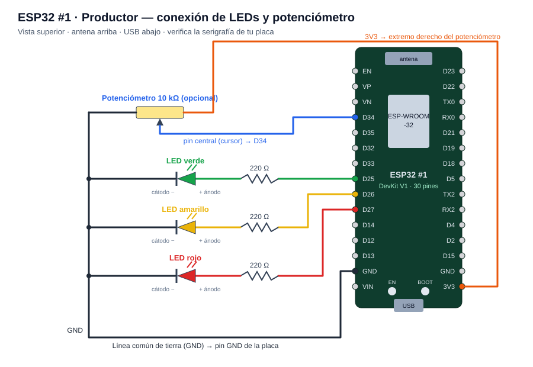
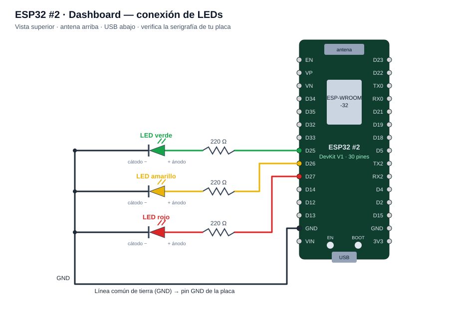
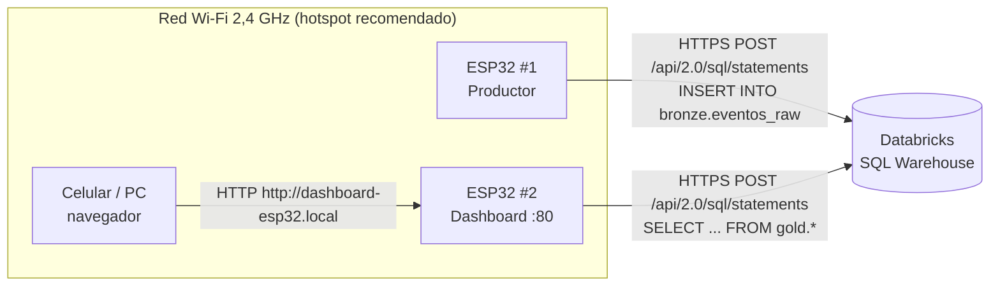

# Manual de conexiones · ESP32

Manual de montaje eléctrico, conexión de red y puesta en marcha de las dos placas ESP32 del proyecto **Lakehouse Medallón con ingesta IoT**.

| Placa | Rol | Sketch |
| --- | --- | --- |
| **ESP32 #1 · Productor** | Genera ventas y las inserta en `bronze.eventos_raw` | [`ESP32_1_Productor.ino`](../ESP32_1_Productor/ESP32_1_Productor.ino) |
| **ESP32 #2 · Dashboard** | Consulta la capa Gold y sirve el centro de mando web | [`ESP32_2_Dashboard.ino`](../ESP32_2_Dashboard/ESP32_2_Dashboard.ino) |

## Contenido

1. [Materiales](#1-materiales)
2. [Mapa de pines](#2-mapa-de-pines)
3. [Cableado del ESP32 #1 · Productor](#3-cableado-del-esp32-1--productor)
4. [Cableado del ESP32 #2 · Dashboard](#4-cableado-del-esp32-2--dashboard)
5. [Montaje paso a paso en la protoboard](#5-montaje-paso-a-paso-en-la-protoboard)
6. [Alimentación](#6-alimentación)
7. [Conexión de red y con Databricks](#7-conexión-de-red-y-con-databricks)
8. [Configuración y carga de los sketches](#8-configuración-y-carga-de-los-sketches)
9. [Prueba de funcionamiento](#9-prueba-de-funcionamiento)
10. [Significado de los LEDs](#10-significado-de-los-leds)
11. [Solución de problemas](#11-solución-de-problemas)

---

## 1. Materiales

| Cant. | Componente | Detalle | ESP32 #1 | ESP32 #2 |
| :-: | --- | --- | :-: | :-: |
| 2 | Placa ESP32 DevKit V1 (30 pines) | Módulo ESP-WROOM-32 | ✔ | ✔ |
| 2 | LED verde 5 mm | | ✔ | ✔ |
| 2 | LED amarillo 5 mm | | ✔ | ✔ |
| 2 | LED rojo 5 mm | | ✔ | ✔ |
| 6 | Resistencia 220 Ω (¼ W) | Rojo-rojo-marrón | 3 | 3 |
| 1 | Potenciómetro 10 kΩ lineal | **Opcional**: ajusta el ritmo de envío | ✔ | – |
| 2 | Protoboard de 400 u 830 puntos | | ✔ | ✔ |
| ~16 | Cables dupont macho-macho | | ~10 | ~6 |
| 2 | Cable USB de **datos** | Micro-USB o USB-C, según la placa | ✔ | ✔ |
| 1 | Power bank (recomendado) | Para la demo sin depender del PC | ✔ | ✔ |

> **Tip:** algunos cables USB solo cargan y no transmiten datos. Si el PC no reconoce la placa, prueba con otro cable antes de buscar otra causa.

---

## 2. Mapa de pines

Las dos placas usan **los mismos pines para los LEDs**, así el montaje es idéntico.

| Pin de la placa | Función | ESP32 #1 | ESP32 #2 | Conexión |
| --- | --- | :-: | :-: | --- |
| **D25** (GPIO 25) | LED verde | ✔ | ✔ | D25 → 220 Ω → ánodo (+) del LED · cátodo (−) → GND |
| **D26** (GPIO 26) | LED amarillo | ✔ | ✔ | D26 → 220 Ω → ánodo (+) del LED · cátodo (−) → GND |
| **D27** (GPIO 27) | LED rojo | ✔ | ✔ | D27 → 220 Ω → ánodo (+) del LED · cátodo (−) → GND |
| **GND** | Tierra común | ✔ | ✔ | Línea azul (−) de la protoboard |
| **D34** (GPIO 34) | Cursor del potenciómetro | opcional | – | Pin central del potenciómetro |
| **3V3** | Alimentación del potenciómetro | opcional | – | Un extremo del potenciómetro (el otro va a GND) |
| **D2** (GPIO 2) | LED azul integrado | ✔ | ✔ | Ya viene en la placa; copia el estado del LED amarillo |
| **BOOT** (GPIO 0) | Botón integrado | ✔ | – | Pausa / reanuda el envío de datos |

**¿Por qué estos pines?**
- **GPIO 25, 26 y 27** quedan juntos en el mismo lado de la placa, son salidas digitales libres y **no intervienen en el arranque**. Por eso se evitan los GPIO 0, 2, 5, 12 y 15: son pines de *strapping* y un LED conectado ahí puede impedir que la placa arranque o se programe.
- **GPIO 34** es una entrada analógica (ADC1) que funciona con el Wi-Fi encendido. Los pines del ADC2 dejan de leer cuando el Wi-Fi está activo.

> ⚠️ El orden de los pines puede variar entre fabricantes. **Guíate siempre por lo que está impreso en tu placa** (D25, D26, D27, GND…), no por la posición física.

---

## 3. Cableado del ESP32 #1 · Productor



| Desde | Hacia | Color de cable sugerido |
| --- | --- | --- |
| D25 | Resistencia 220 Ω → ánodo del LED **verde** | Verde |
| D26 | Resistencia 220 Ω → ánodo del LED **amarillo** | Amarillo |
| D27 | Resistencia 220 Ω → ánodo del LED **rojo** | Rojo |
| Cátodos de los 3 LEDs | Línea GND de la protoboard | Negro |
| GND de la placa | Línea GND de la protoboard | Negro |
| *(Opcional)* Pin central del potenciómetro | D34 | Azul |
| *(Opcional)* Extremo derecho del potenciómetro | 3V3 | Naranja |
| *(Opcional)* Extremo izquierdo del potenciómetro | Línea GND | Negro |

Para usar el potenciómetro, cambia en el sketch `#define USAR_POTENCIOMETRO 0` por `1`. Al girarlo, el intervalo entre lotes cambia entre **5 y 60 segundos**.

> El potenciómetro va a **3V3, nunca a VIN/5V**: los pines del ESP32 solo toleran 3,3 V.

---

## 4. Cableado del ESP32 #2 · Dashboard



| Desde | Hacia | Color de cable sugerido |
| --- | --- | --- |
| D25 | Resistencia 220 Ω → ánodo del LED **verde** | Verde |
| D26 | Resistencia 220 Ω → ánodo del LED **amarillo** | Amarillo |
| D27 | Resistencia 220 Ω → ánodo del LED **rojo** | Rojo |
| Cátodos de los 3 LEDs | Línea GND de la protoboard | Negro |
| GND de la placa | Línea GND de la protoboard | Negro |

---

## 5. Montaje paso a paso en la protoboard

1. **Desconecta la placa del USB** antes de cablear.
2. **Inserta el ESP32 a horcajadas** sobre el canal central de la protoboard, de modo que cada fila de pines quede en un lado distinto. En una protoboard de 400 puntos solo queda libre una columna por lado. Si te queda muy justo, usa dos protoboards unidas o conecta la placa por fuera con cables dupont hembra-macho.
3. **Identifica la polaridad de cada LED.** La pata **larga** es el **ánodo (+)** y la **corta** el **cátodo (−)**; el cátodo también se reconoce por el borde plano de la cápsula.
4. Coloca los **3 LEDs** en la zona libre, cada uno en filas distintas, con el **cátodo hacia la línea azul (−)**.
5. Conecta **cada cátodo a la línea azul (GND)** con un cable negro corto o directamente, si la pata alcanza.
6. Coloca **una resistencia de 220 Ω por LED**, desde la fila del ánodo hasta una fila libre. La resistencia no tiene polaridad.
7. Une con un cable dupont cada resistencia con su pin: **verde → D25**, **amarillo → D26**, **rojo → D27**.
8. Conecta un **GND de la placa** a la línea azul (−).
9. *(Solo ESP32 #1, opcional)* coloca el potenciómetro: pin central → **D34**, un extremo → **3V3** y el otro → **GND**.
10. **Revisa antes de energizar:** ningún LED sin resistencia, ningún cable de 3V3 tocando GND y cada LED con el cátodo hacia GND.

**¿Por qué 220 Ω?** Limita la corriente a unos 5–6 mA por LED, (3,3 V − 2,0 V) / 220 Ω ≈ 6 mA. Eso basta para que se vean bien y queda muy por debajo del máximo que soporta cada pin del ESP32. Si el **LED verde** se ve muy tenue (los verdes brillantes necesitan cerca de 3 V), cámbiale la resistencia por una de **100 Ω**.

---

## 6. Alimentación

| Opción | Cuándo usarla |
| --- | --- |
| USB del PC | Mientras programas y ves el Monitor Serie |
| Power bank o cargador USB de 5 V | En la sustentación; las placas funcionan solas una vez programadas |

- **No alimentes la placa por VIN y por USB al mismo tiempo.**
- Los 3 LEDs consumen menos de 20 mA en total, así que no requieren fuente externa.
- Las dos placas pueden ir a un mismo power bank con dos salidas, o a un hub USB.

---

## 7. Conexión de red y con Databricks



| Conexión | Protocolo | Datos que necesitas |
| --- | --- | --- |
| ESP32 → Wi-Fi | 802.11 b/g/n, **solo 2,4 GHz** | Nombre (SSID) y clave de la red |
| ESP32 → Databricks | HTTPS, puerto 443, API REST *SQL Statement Execution* | Host del workspace, token personal, ID del SQL Warehouse y catálogo |
| Navegador → ESP32 #2 | HTTP, puerto 80, en la red local | La IP que imprime el Monitor Serie o `dashboard-esp32.local` |

**Requisitos de la red**
- Debe ser de **2,4 GHz**: el ESP32 no se conecta a redes de 5 GHz. En el celular, activa la opción *compatibilidad / banda 2,4 GHz* del hotspot.
- **Sin portal cautivo**, es decir, sin página de inicio de sesión como la del Wi-Fi institucional.
- Los dos ESP32 y el celular o PC del dashboard deben estar en la **misma red**.
- Algunas redes aíslan a los clientes entre sí (*AP isolation*); en ese caso el navegador no podrá abrir la página del ESP32 #2. El hotspot del celular normalmente no tiene ese problema.

**Dónde obtener los datos de Databricks**

| Dato | Dónde se encuentra |
| --- | --- |
| `DATABRICKS_HOST` | La URL del workspace, sin `https://`. Ej.: `dbc-2e9d45b0-5357.cloud.databricks.com` |
| `DATABRICKS_TOKEN` | Avatar → **Settings → Developer → Access tokens → Generate new token** |
| `WAREHOUSE_ID` | **SQL Warehouses → Serverless Starter Warehouse → Connection details → HTTP path**: es la parte final, después de `/warehouses/` |
| `CATALOG` | Lo imprime la celda 00 del notebook (`proyecto_nota3` o `workspace`) |

---

## 8. Configuración y carga de los sketches

### 8.1 Preparar Arduino IDE (solo una vez)
1. Ve a **Archivo → Preferencias → URLs adicionales del gestor de placas** y agrega:
   `https://espressif.github.io/arduino-esp32/package_esp32_index.json`
2. En **Herramientas → Placa → Gestor de placas**, instala **esp32 (Espressif Systems)**.
3. En **Programa → Incluir librería → Gestionar librerías**, instala **ArduinoJson** (Benoit Blanchon, **v7**).
4. *(Windows)* Si la placa no aparece como puerto COM, instala el driver **CP210x** o **CH340**, según el chip USB de tu placa.

### 8.2 Editar la configuración
En cada sketch, completa el bloque `CONFIGURACIÓN (EDITAR)`:

```cpp
const char* WIFI_SSID        = "TU_WIFI";
const char* WIFI_PASS        = "TU_CLAVE_WIFI";
const char* DATABRICKS_HOST  = "dbc-xxxxxxxx-xxxx.cloud.databricks.com";
const char* DATABRICKS_TOKEN = "dapi...";
const char* WAREHOUSE_ID     = "xxxxxxxxxxxxxxxx";
const char* CATALOG          = "proyecto_nota3";   // o "workspace"
```

> 🔒 **No hagas commit de estos valores.** Edítalos solo en tu copia local. Si ya los subiste por error, **revoca el token** en Databricks y genera uno nuevo.

### 8.3 Subir el sketch
1. Conecta la placa por USB y selecciona:
   - **Herramientas → Placa:** `ESP32 Dev Module`
   - **Herramientas → Puerto:** el COM que aparece al conectar la placa
2. Pulsa **Subir (→)**. Si se queda en `Connecting...`, **mantén presionado BOOT** hasta que empiece a escribir.
3. Abre el **Monitor Serie** a **115200 baudios** y pulsa **EN** para reiniciar.
4. Repite el proceso con la otra placa y su sketch.

---

## 9. Prueba de funcionamiento

**Orden recomendado:** primero ejecuta el notebook hasta la celda **6d**, luego enciende el **ESP32 #2** y por último el **ESP32 #1**.

| # | Qué hacer | Resultado esperado |
| :-: | --- | --- |
| 1 | Encender la placa | **Autodiagnóstico**: verde → amarillo → rojo se encienden en secuencia y luego se apagan |
| 2 | Esperar la conexión Wi-Fi | El amarillo parpadea. En el Monitor Serie: `Wi-Fi OK. IP: 192.168.x.x` |
| 3 | ESP32 #1 envía el primer lote | El amarillo se enciende mientras transmite; después, el verde queda fijo. Monitor: `Lote #1 enviado (20 eventos...) -> SUCCEEDED` |
| 4 | Pulsar **BOOT** en el ESP32 #1 | El verde pasa a parpadear (pausa). Al pulsarlo otra vez vuelve a quedar fijo |
| 5 | ESP32 #2 consulta Gold | El amarillo se enciende durante la consulta; después, el verde queda fijo. Monitor: `Datos actualizados (... bytes ...)` |
| 6 | Llegan eventos nuevos del ESP32 #1 | El verde del ESP32 #2 da **3 destellos**. Monitor: `Nuevos eventos del ESP32 #1: +20` |
| 7 | Abrir `http://dashboard-esp32.local` o la IP | Aparece el centro de mando con el indicador **EN VIVO** |
| 8 | Prueba de falla: apagar el hotspot unos segundos | Se enciende el **rojo**; al volver la red se apaga solo |

---

## 10. Significado de los LEDs

| LED | ESP32 #1 · Productor | ESP32 #2 · Dashboard |
| --- | --- | --- |
| 🟢 **Verde** | **Fijo:** Wi-Fi OK y enviando · **Parpadea:** en pausa (BOOT) · **Apagado:** sin Wi-Fi | **Fijo:** datos de Gold al día · **3 destellos:** llegaron eventos nuevos del ESP32 #1 |
| 🟡 **Amarillo** | **Fijo:** transmitiendo un lote · **Parpadea:** conectando al Wi-Fi | **Fijo:** consultando Databricks · **Parpadea:** conectando al Wi-Fi |
| 🔴 **Rojo** | El último lote falló o no hay Wi-Fi | La última consulta falló o no hay Wi-Fi |
| 🔵 Azul integrado | Copia del amarillo | Copia del amarillo |
| Secuencia 🟢🟡🔴 al encender | Autodiagnóstico: los 3 LEDs y su cableado funcionan | Igual |

---

## 11. Solución de problemas

| Síntoma | Causa probable | Solución |
| --- | --- | --- |
| Un LED no enciende en el autodiagnóstico | LED invertido, mal insertado o sin conexión a GND | Gira el LED (pata larga hacia la resistencia) y revisa el cable a la línea GND |
| Ningún LED enciende | El GND de la placa no está conectado a la línea azul | Conecta un pin **GND** de la placa a la línea (−) |
| El LED verde se ve muy débil | LED verde de alto voltaje directo | Cambia su resistencia a 100 Ω |
| El PC no detecta la placa | El cable solo carga o falta el driver | Usa un cable de datos e instala el driver CP210x o CH340 |
| `Connecting........____` al subir | La placa no entró en modo de programación | Mantén **BOOT** presionado al iniciar la carga |
| La placa se reinicia en bucle | Hay un LED en un pin de arranque, o la alimentación es débil | Usa solo D25, D26 y D27, y prueba otro cable o puerto USB |
| Amarillo parpadeando sin fin | No se conecta al Wi-Fi | Verifica SSID y clave, que la red sea de 2,4 GHz y que no tenga portal cautivo |
| Rojo encendido y `HTTP 401` / `403` | Token inválido o vencido | Genera un token nuevo y actualiza `DATABRICKS_TOKEN` |
| Rojo encendido y `HTTP 404` o `warehouse` en el error | Host o `WAREHOUSE_ID` incorrecto | Copia de nuevo el host y el ID desde *Connection details* |
| Rojo encendido y `TABLE_OR_VIEW_NOT_FOUND` | Catálogo equivocado o el notebook no se ha ejecutado | Revisa `CATALOG` y ejecuta el notebook hasta la celda 6d (y la 14) |
| `PENDING` en el primer lote | El SQL Warehouse estaba apagado y está arrancando | Es normal; los siguientes lotes salen `SUCCEEDED` |
| La página del ESP32 #2 no abre | El navegador está en otra red, la red aísla clientes o `.local` no funciona | Usa la IP del Monitor Serie y el hotspot del celular |
| El potenciómetro no cambia el ritmo | `USAR_POTENCIOMETRO` sigue en `0` o el cursor no va a D34 | Cámbialo a `1` y conecta el pin central a D34 |

---

← Volver al [README](../README.md) · Ver también la [Guía de montaje](../LEEME_Guia_de_montaje.md) y la [Guía de dashboards](../LEEME_Dashboards.md)
